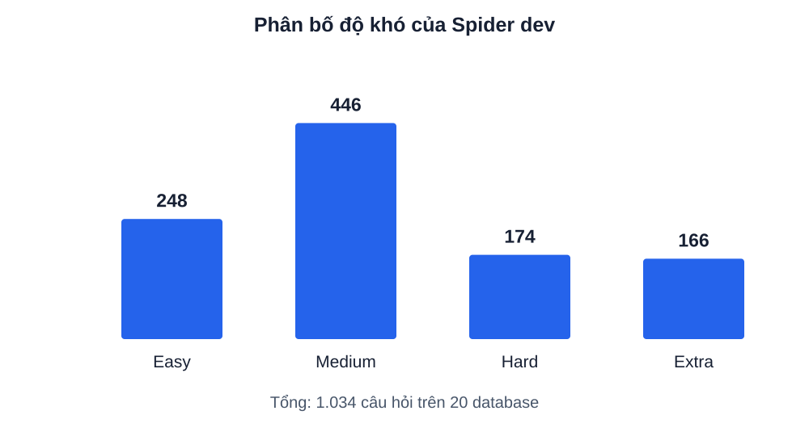
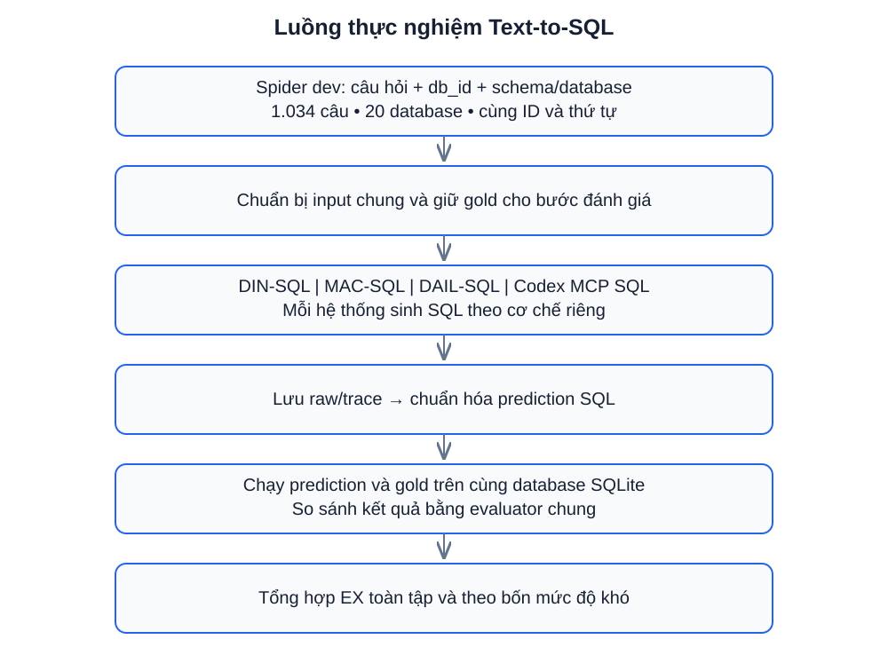
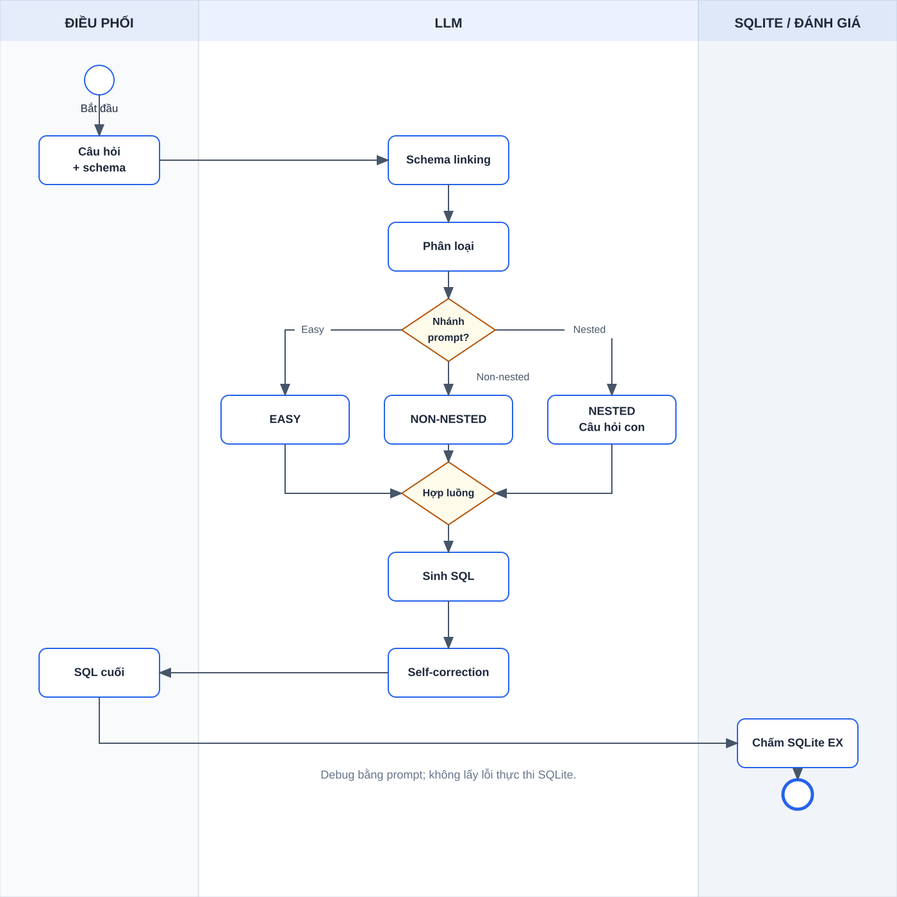
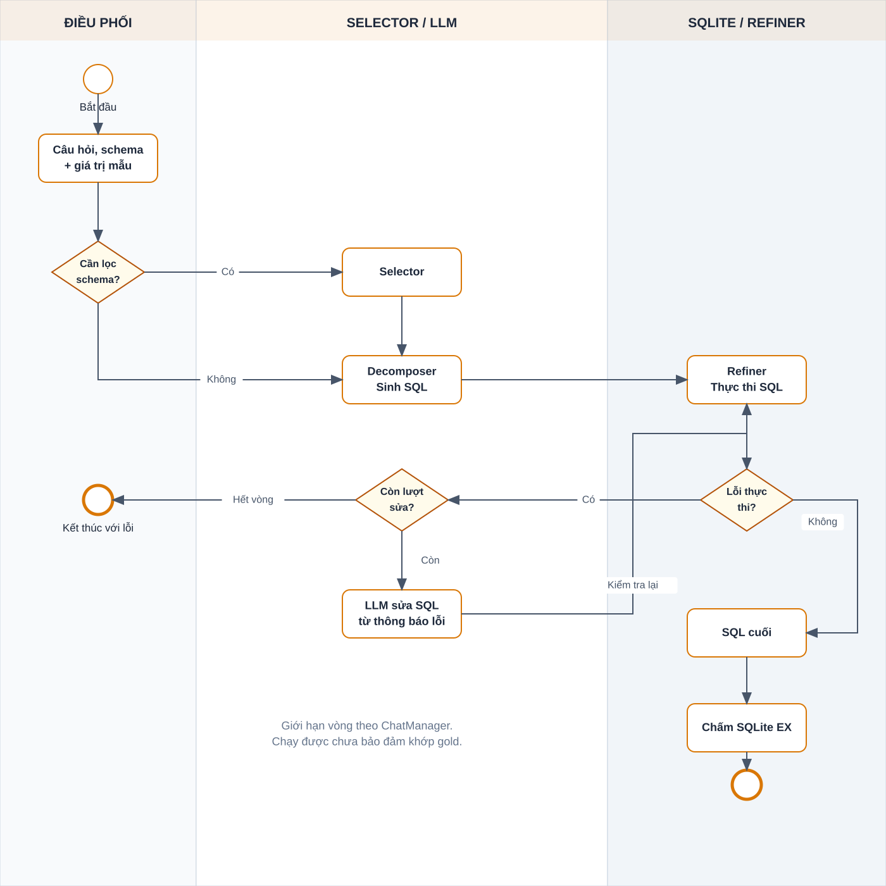
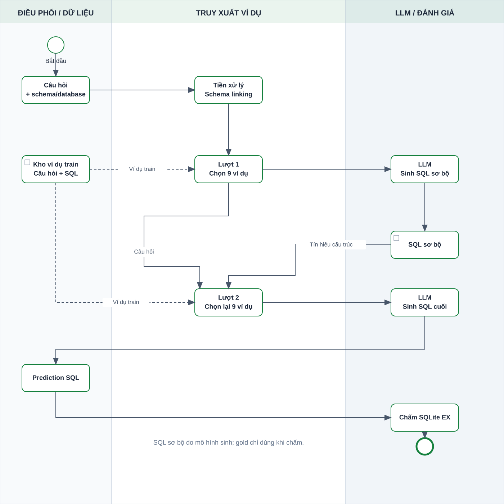
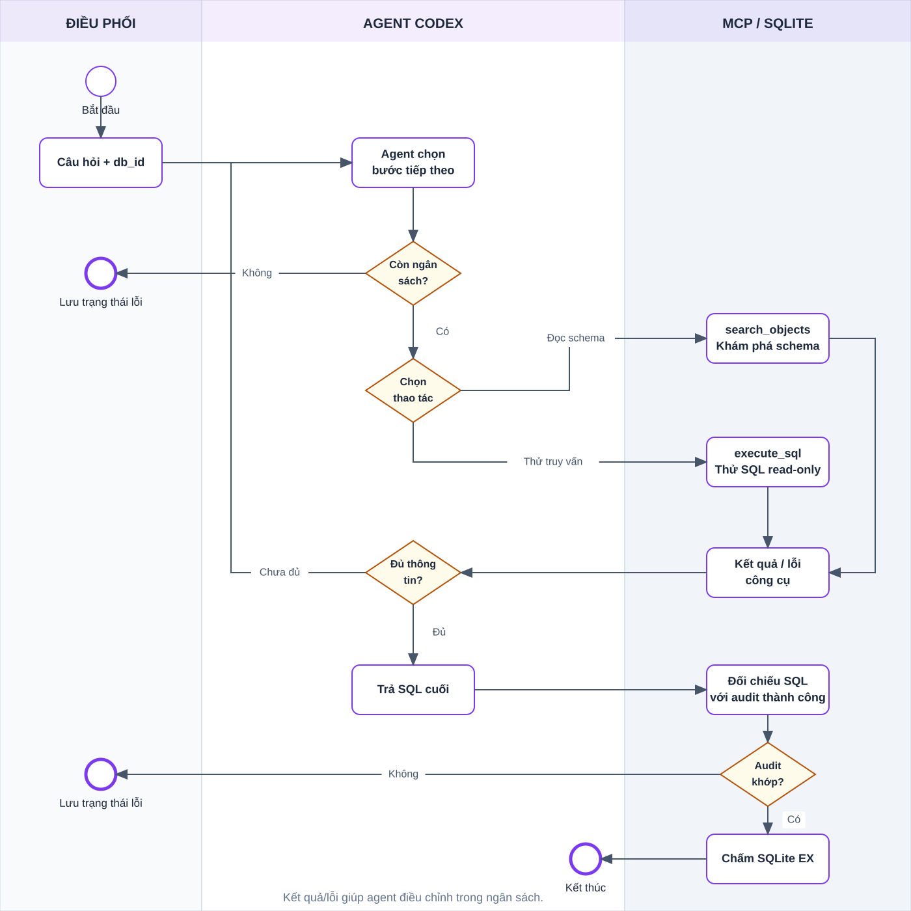
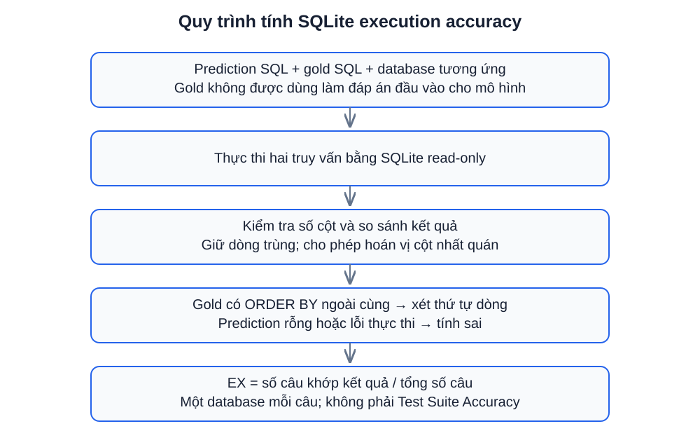
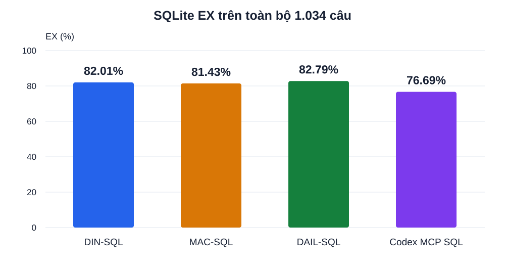
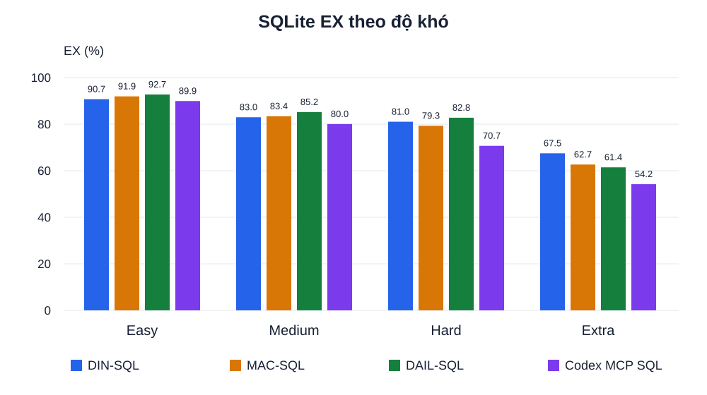

# SO SÁNH CÁC PHƯƠNG PHÁP SINH TRUY VẤN SQL TỪ NGÔN NGỮ TỰ NHIÊN TRÊN BỘ DỮ LIỆU SPIDER

## Tóm tắt

Text-to-SQL là bài toán chuyển câu hỏi ngôn ngữ tự nhiên thành truy vấn SQL trên một cơ sở dữ liệu cho trước. Báo cáo trình bày việc tích hợp và đánh giá bốn hệ thống DIN-SQL, MAC-SQL, DAIL-SQL và Codex MCP SQL trên tập phát triển Spider 1.0, gồm 1.034 câu hỏi thuộc 20 cơ sở dữ liệu. Các hệ thống sử dụng cùng danh sách câu hỏi, thứ tự và cơ sở dữ liệu; SQL đầu ra được chuẩn hóa và đánh giá bằng kết quả thực thi trên SQLite.

Trong lượt thực nghiệm đã lưu, DAIL-SQL đạt execution accuracy (EX) cao nhất với 82,79%, tiếp theo là DIN-SQL 82,01%, MAC-SQL 81,43% và Codex MCP SQL 76,69%. DAIL-SQL dẫn đầu ở các nhóm Easy, Medium và Hard, còn DIN-SQL có điểm cao nhất ở nhóm Extra. Các ví dụ thực tế từ ứng dụng theo dõi pipeline cho thấy những hệ thống có cơ chế xử lý khác nhau vẫn có thể sinh SQL tương đương về kết quả. Phản hồi công cụ giúp phát hiện vấn đề khi thao tác với cơ sở dữ liệu, nhưng thực thi thành công chưa bảo đảm truy vấn đúng với đáp án.

Do backend, công cụ và cấu hình suy luận giữa các hệ thống có khác biệt, kết quả được diễn giải như một phép so sánh hệ thống trong cấu hình cụ thể. Chỉ số báo cáo là EX trên một cơ sở dữ liệu cho mỗi câu hỏi; không phải Test Suite Accuracy. Báo cáo đồng thời phân tích giới hạn này để tránh suy rộng kết quả sang các cấu hình hoặc bộ dữ liệu khác.

**Từ khóa:** Text-to-SQL, Spider, DIN-SQL, MAC-SQL, DAIL-SQL, MCP, execution accuracy.

# 1. Giới thiệu

## 1.1. Bối cảnh

Cơ sở dữ liệu quan hệ lưu trữ thông tin dưới dạng bảng và được truy vấn bằng SQL. Để lấy đúng dữ liệu, người sử dụng thường phải hiểu cấu trúc cơ sở dữ liệu, xác định bảng và cột liên quan, đồng thời biết kết hợp các mệnh đề SQL. Điều này tạo ra trở ngại khi người cần khai thác dữ liệu chưa có kiến thức lập trình hoặc chưa quen với schema đang sử dụng.

Text-to-SQL hướng tới việc cho phép người dùng đặt câu hỏi bằng ngôn ngữ tự nhiên. Hệ thống tiếp nhận câu hỏi, tìm hiểu schema và sinh truy vấn SQL tương ứng. Ví dụ, yêu cầu đếm số tàu có trạng thái Captured cần được ánh xạ thành phép đếm trên bảng chứa thông tin tàu, kèm điều kiện lọc đúng cột trạng thái.

Mô hình ngôn ngữ có thể sinh SQL, nhưng việc sử dụng mô hình trong một pipeline còn nhiều lựa chọn: cung cấp schema như thế nào, đưa ví dụ nào vào prompt, có phân rã câu hỏi hay không, và có cho phép thực thi SQL để lấy phản hồi hay không. Vì vậy, cần so sánh cả quy trình xử lý và kết quả đầu ra của các phương pháp.

## 1.2. Định nghĩa bài toán

Đầu vào gồm câu hỏi ngôn ngữ tự nhiên và thông tin về cơ sở dữ liệu cần truy vấn. Tùy phương pháp, thông tin này có thể được cung cấp sẵn trong prompt hoặc được truy cập bằng công cụ. Đầu ra là truy vấn SQL có thể thực thi trên cơ sở dữ liệu đó và trả lời đúng yêu cầu.

Ví dụ thực tế trong Spider dev, với database `battle_death`:

> How many ships ended up being 'Captured'?
>
> Có bao nhiêu tàu có trạng thái Captured?

Một SQL trả lời câu hỏi là:

```sql
SELECT COUNT(*)
FROM ship
WHERE disposition_of_ship = 'Captured';
```

Các thành phần cần xác định gồm bảng `ship`, cột `disposition_of_ship`, giá trị `'Captured'` và phép tổng hợp `COUNT(*)`. Cách viết SQL có thể khác nhau, nhưng kết quả phải phù hợp với câu hỏi.

## 1.3. Các khó khăn

Thứ nhất, cách diễn đạt của câu hỏi thường không trùng hoàn toàn tên cột trong cơ sở dữ liệu. Hệ thống phải liên hệ cụm từ trong câu hỏi với bảng, cột và giá trị tương ứng. Bước xác định liên hệ này thường được gọi là schema linking.

Thứ hai, câu hỏi có thể yêu cầu JOIN nhiều bảng, GROUP BY, HAVING, truy vấn lồng hoặc phép toán tập hợp. Chọn đúng bảng chưa đủ; hệ thống còn phải xây dựng đúng quan hệ và thứ tự xử lý.

Thứ ba, SQL hợp lệ về cú pháp vẫn có thể sai nghĩa. Chẳng hạn, chọn thêm một cột hoặc thay đổi kiểu JOIN có thể làm kết quả khác đáp án dù truy vấn chạy bình thường.

Cuối cùng, phương pháp cần làm việc với nhiều schema khác nhau. Việc chỉ xử lý tốt một cơ sở dữ liệu chưa chứng minh khả năng tổng quát sang các cơ sở dữ liệu mới.

## 1.4. Mục tiêu và phạm vi

Báo cáo tập trung vào ba câu hỏi:

1. Bốn hệ thống sinh SQL theo những luồng xử lý nào và khác nhau ở điểm nào?
2. Hệ thống nào đạt EX cao nhất trong lượt chạy trên toàn bộ Spider dev và từng nhóm độ khó?
3. Các ví dụ thực tế và kết quả kiểm tra prediction cho thấy điều gì về tính hợp lệ và độ đúng của SQL?

Phạm vi thực nghiệm là Spider 1.0 dev, không bao gồm Spider 2.0. Pipeline không fine-tune mô hình. Phần triển khai gồm chuẩn bị input chung, tích hợp runner, thu thập đầu ra, chuẩn hóa SQL, xây dựng evaluator SQLite và cung cấp giao diện theo dõi các bước xử lý. Codex MCP SQL là hệ thống tích hợp trong workspace để đối chiếu với ba phương pháp còn lại.

# 2. Dữ liệu thực nghiệm

## 2.1. Bộ dữ liệu và tập đánh giá

Spider là bộ dữ liệu cho bài toán chuyển câu hỏi ngôn ngữ tự nhiên thành SQL trên nhiều cơ sở dữ liệu. Báo cáo sử dụng tập dev có sẵn trong workspace làm tập đánh giá chung. Tập này chứa 1.034 câu hỏi trên 20 database SQLite.

Các câu hỏi gốc sử dụng tiếng Anh. Bản dịch tiếng Việt trong báo cáo phục vụ giải thích; đầu vào mô hình trong những phiên được khảo sát vẫn là câu hỏi tiếng Anh gốc.

**Bảng 2.1. Thành phần dữ liệu sử dụng trong workspace**

| Thành phần | Quy mô hoặc nội dung | Vai trò |
|---|---|---|
| `dev.json` | 1.034 câu hỏi, 20 database | Tập đánh giá chung |
| `train_spider.json` | 7.000 câu, 140 database theo thống kê workspace | Nguồn ví dụ cho DAIL-SQL |
| `train_others.json` | 1.659 câu, 6 database theo thống kê workspace | Dữ liệu bổ sung trong preprocessing DAIL-SQL |
| `tables.json` | Tên bảng/cột, kiểu dữ liệu, khóa | Thông tin schema |
| `database/` | File SQLite của các database | Đọc dữ liệu và thực thi SQL |

Các câu train không được cộng vào mẫu số 1.034 câu đánh giá. DAIL-SQL sử dụng chúng để chọn ví dụ few-shot, không dùng để cập nhật trọng số mô hình. DIN-SQL sử dụng các ví dụ đã được viết sẵn trong mã nguồn.

## 2.2. Cấu trúc mẫu dữ liệu

Một mẫu rút gọn từ câu đầu của dev có dạng:

```json
{
  "db_id": "concert_singer",
  "question": "How many singers do we have?",
  "query": "SELECT count(*) FROM singer"
}
```

Trường `db_id` xác định cơ sở dữ liệu; `question` là câu hỏi; `query` là SQL tham chiếu, còn gọi là gold SQL. Ngoài ra, dữ liệu gốc có các trường token và cấu trúc SQL đã parse để phục vụ xử lý, phân tích.

Schema cung cấp tên bảng/cột, kiểu dữ liệu, khóa chính và khóa ngoại. Báo cáo chỉ giải thích những bảng/cột cần thiết cho ví dụ, không đi sâu trình bày sơ đồ quan hệ của từng database.

Gold SQL được sử dụng ở bước đánh giá. Với DAIL-SQL, SQL sơ bộ dùng để chọn lại ví dụ là output của mô hình ở lượt đầu, không phải gold SQL của câu đang đánh giá.

## 2.3. Phân bố độ khó

Độ khó được xác định từ cấu trúc gold SQL bằng evaluator Spider. Các nhãn không đơn thuần phản ánh độ dài câu hỏi, mà gắn với những thành phần cấu trúc của truy vấn.

**Bảng 2.2. Phân bố độ khó trên tập dev**

| Độ khó | Số câu | Tỷ lệ |
|---|---:|---:|
| Easy | 248 | 23,98% |
| Medium | 446 | 43,13% |
| Hard | 174 | 16,83% |
| Extra | 166 | 16,05% |
| Tổng | 1.034 | 100% |

*Tỷ lệ làm tròn đến hai chữ số thập phân nên tổng các tỷ lệ thành phần có thể lệch 0,01%.*



*Hình 2.1. Phân bố độ khó của 1.034 câu Spider dev.*

Medium là nhóm lớn nhất, chiếm hơn 43% số câu. Vì các nhóm có kích thước khác nhau, EX toàn tập là trung bình có trọng số theo số câu, không phải trung bình cộng đơn giản của bốn tỷ lệ theo độ khó.

## 2.4. Chuẩn bị dữ liệu

Script `prepare_data.py` tạo input chung và giữ nguyên thứ tự. Với full dev, ID được gán từ `dev_0000` đến `dev_1033`. Các phương pháp được so sánh trên cùng danh sách ID và cùng database.

Dữ liệu chuẩn bị gồm các mẫu có ID, schema, gold, danh sách thứ tự và thông tin nguồn. Checksum được lưu để hỗ trợ phát hiện thay đổi dữ liệu. Việc file phục vụ runner/evaluator có chứa gold không có nghĩa toàn bộ file được gửi vào prompt: mỗi adapter chỉ xây dựng đầu vào cần thiết cho phương pháp.

Một chế độ chạy thử lấy N câu đầu được sử dụng để kiểm tra pipeline. Tuy nhiên, 20 câu đầu đều thuộc `concert_singer`, nên smoke20 không đại diện cho toàn bộ 20 database. Kết quả chính trong báo cáo sử dụng đủ 1.034 câu.

# 3. Các phương pháp và luồng xử lý

## 3.1. Kiến trúc thực nghiệm chung

Từ dữ liệu Spider, hệ thống chuẩn bị input thống nhất rồi gọi các runner. Đầu ra thô và log được lưu trước khi chuẩn hóa thành prediction SQL. Evaluator thực thi prediction và gold trên SQLite, sau đó xuất điểm toàn tập và theo độ khó.



*Hình 3.1. Luồng chuẩn bị dữ liệu, sinh SQL, chuẩn hóa và đánh giá chung.*

Điểm dùng chung là câu hỏi, database và evaluator. Cách cung cấp schema, lựa chọn ví dụ, số lần gọi mô hình và việc sử dụng công cụ phụ thuộc từng hệ thống. Phần tiếp theo mô tả implementation được runner sử dụng, không khẳng định mọi cấu hình của phương pháp gốc đều có cùng hành vi.

## 3.2. DIN-SQL

### 3.2.1. Ý tưởng

DIN-SQL tổ chức việc sinh SQL thành các bước prompting. Thay vì yêu cầu mô hình tạo SQL ngay từ đầu, pipeline xác định thành phần liên quan, phân loại câu hỏi, sinh SQL theo nhánh phù hợp rồi yêu cầu sửa lại SQL.

### 3.2.2. Các bước xử lý

1. **Schema linking:** xác định bảng/cột, quan hệ và giá trị liên quan.
2. **Phân loại:** chọn nhãn nội bộ EASY, NON-NESTED hoặc NESTED.
3. **Sinh SQL:** sử dụng prompt tương ứng; câu hỏi phức tạp có thể được phân rã thành câu hỏi con.
4. **Self-correction:** yêu cầu LLM kiểm tra và sửa SQL ứng viên.

Khi không có retry, một câu đi qua bốn bước gọi LLM. Bước self-correction trong implementation này dựa trên câu hỏi, schema và SQL ứng viên, không nhận lỗi thực thi SQLite. Các nhãn nội bộ của DIN-SQL khác bốn nhãn Easy, Medium, Hard, Extra dùng trong thống kê Spider.



*Hình 3.2. Luồng DIN-SQL theo phong cách BPMN, dựng bằng HTML/SVG. Phần ví dụ đối chiếu với phiên `c9a7a364f737`, câu `dev_0491`; các nhánh thể hiện cơ chế tổng quát.*

### 3.2.3. Minh hoạ thực tế

Với câu hỏi đếm tàu Captured, trace ghi nhận bốn lời gọi tương ứng schema linking, classification, SQL generation và self-correction. SQL ở bước sinh và SQL cuối có cùng logic:

```sql
SELECT COUNT(*)
FROM ship
WHERE disposition_of_ship = 'Captured';
```

Khi evaluator thực thi SQL cuối, kết quả là `4` và khớp gold. Việc SQL không đổi sau self-correction cho thấy một bước kiểm tra có thể xác nhận ứng viên hiện có mà không nhất thiết tạo truy vấn khác.

### 3.2.4. Đặc điểm

Cấu trúc nhiều bước giúp quan sát rõ từng phần công việc. Tuy nhiên, lỗi từ schema linking hoặc phân loại có thể ảnh hưởng các bước sau. Do không sử dụng phản hồi thực thi trong bước debug, pipeline không trực tiếp tận dụng lỗi SQLite để sửa SQL ứng viên.

## 3.3. MAC-SQL

### 3.3.1. Ý tưởng

MAC-SQL tổ chức pipeline thành ba vai trò Selector, Decomposer và Refiner. Các vai trò được điều phối trong ChatManager; chúng không nhất thiết tương ứng ba mô hình độc lập.

### 3.3.2. Các bước xử lý

**Selector** chọn các bảng/cột cần thiết khi schema đủ lớn để cần thu gọn. Với schema nhỏ, bước này có thể giữ nguyên thông tin mà không gọi LLM riêng. Mô tả schema còn bao gồm giá trị mẫu đọc từ database.

**Decomposer** xử lý câu hỏi, thực hiện phân rã khi cần và sinh SQL ứng viên.

**Refiner** thực thi SQL. Khi có lỗi thực thi, hệ thống có thể đưa SQL và lỗi cho LLM sửa rồi kiểm tra lại, trong giới hạn vòng của ChatManager (`MAX_ROUND=3`). Với cấu hình Spider đang dùng, kết quả rỗng hoặc có NULL không tự động kích hoạt sửa.



*Hình 3.3. Luồng MAC-SQL có các nút quyết định và vòng sửa SQL. Ví dụ `dev_0491` không đi qua nhánh LLM sửa lỗi.*

### 3.3.3. Minh hoạ thực tế

Trong phiên `c9a7a364f737`, state của Selector giữ schema gồm các bảng `battle`, `ship`, `death` rồi chuyển sang Decomposer. Trace không ghi lời gọi LLM riêng cho Selector. Decomposer sinh truy vấn đếm tàu Captured. Sau Refiner, state chuyển sang System và không có lời gọi LLM sửa SQL.

SQL cuối trả về `4` và khớp gold. Vì vậy, không nên mô tả ví dụ này như một trường hợp Refiner đã sửa SQL sai thành đúng: trace chỉ cho thấy ứng viên được kiểm tra và chấp nhận.

### 3.3.4. Đặc điểm

Phản hồi thực thi cho phép MAC-SQL sửa những lỗi được SQLite phát hiện. Tuy nhiên, một truy vấn chạy được vẫn có thể sai điều kiện, phép tổng hợp hoặc lựa chọn cột. Cơ chế kiểm tra thực thi không thay thế việc đánh giá độ đúng ngữ nghĩa.

## 3.4. DAIL-SQL

### 3.4.1. Ý tưởng

DAIL-SQL tập trung vào lựa chọn và tổ chức ví dụ few-shot. Ví dụ phù hợp giúp cung cấp mẫu ánh xạ giữa câu hỏi và SQL cho câu mới. Trong pipeline đang dùng, việc lựa chọn được thực hiện qua hai lượt, kết hợp tín hiệu từ câu hỏi và SQL sơ bộ.

### 3.4.2. Các bước xử lý

1. Tiền xử lý dữ liệu train và dev, tokenize và schema linking.
2. Lượt đầu chọn 9 cặp câu hỏi/SQL theo câu hỏi đã mask.
3. Mô hình sinh SQL sơ bộ.
4. Lượt sau chọn lại 9 ví dụ dựa trên câu hỏi và cấu trúc SQL sơ bộ.
5. Mô hình sinh SQL cuối từ prompt mới.

Schema được biểu diễn dạng SQL. Cấu hình hai lượt dùng `n=1`, context 4.096 và temperature 0. Các selector trong runner lần lượt là `EUCDISQUESTIONMASK` và `EUCDISMASKPRESKLSIMTHR`. Bước mask tạo biểu diễn phục vụ so sánh câu hỏi; SQL sơ bộ bổ sung tín hiệu cấu trúc để chọn ví dụ ở lượt sau.



*Hình 3.4. Luồng hai lượt DAIL-SQL theo phong cách BPMN. Phần ví dụ sử dụng trace thật của phiên `2b92fef50db2`, câu `dev_0491`.*

### 3.4.3. Minh hoạ thực tế hai lượt

Sau khi bổ sung DAIL-SQL vào dashboard, phiên `2b92fef50db2` chạy cùng câu hỏi `dev_0491` trên `battle_death` đã hoàn tất bằng model thật. Đây là phiên minh hoạ bổ sung, không phải chạy lại benchmark 1.034 câu.

Ở lượt một, hệ thống chọn 9 ví dụ train. Ví dụ đứng đầu trong danh sách được ghi nhận là câu hỏi về tên bác sĩ có lịch hẹn (`hospital_1`); ví dụ tiếp theo hỏi số vùng chịu ảnh hưởng của từng cơn bão (`storm_record`). SQL sơ bộ mô hình sinh là:

```sql
SELECT COUNT(*)
FROM ship
WHERE disposition_of_ship = 'Captured';
```

Ở lượt hai, hệ thống tiếp tục chọn 9 ví dụ nhưng danh sách thay đổi. Hai ví dụ đầu lần lượt hỏi số buổi học của khách hàng tên Ray (`driving_school`) và số bệnh nhân ở phòng 112 (`hospital_1`). Các truy vấn này có phép đếm kết hợp điều kiện lọc, gần với cấu trúc SQL sơ bộ hơn về các thao tác cần thực hiện.

SQL cuối giữ nguyên logic của SQL sơ bộ và trả về `4`, khớp gold. Trường hợp này cho thấy bước chọn lại ví dụ đã thực sự diễn ra, dù SQL ở hai lượt không thay đổi. Không thể từ một câu thành công kết luận việc chọn lại ví dụ luôn cải thiện độ chính xác.

### 3.4.4. Đặc điểm

Điểm khác biệt là thay đổi tập ví dụ theo câu hỏi thay vì chỉ sử dụng một tập ví dụ cố định. SQL sơ bộ không đúng hoàn toàn vẫn có thể cung cấp thông tin cấu trúc, nhưng chất lượng của nó cũng có thể ảnh hưởng việc lựa chọn lượt sau.

Pipeline có bước schema linking với giá trị trong database, nhưng không có vòng thực thi SQL ứng viên để lấy lỗi sửa truy vấn như MAC-SQL. Các tài nguyên riêng gồm embedding `all-mpnet-base-v2`, CoreNLP và dữ liệu train.

## 3.5. Codex MCP SQL

### 3.5.1. Ý tưởng

Codex MCP SQL cho phép agent tương tác với database qua các công cụ MCP. Agent nhận câu hỏi và `db_id`, sau đó tự lựa chọn chuỗi thao tác để tìm schema, thử truy vấn và trả SQL cuối trong ngân sách cho phép.

### 3.5.2. Công cụ và vòng xử lý

Hai công cụ chính là:

- `search_objects`: tìm đối tượng database, đọc DDL, cột và khóa.
- `execute_sql`: thực thi truy vấn read-only trên database tương ứng và trả dữ liệu hoặc lỗi.

Mỗi câu được xử lý trong một phiên riêng. Cấu hình ghi nhận trong thực nghiệm gồm effort `low`, tối đa 20 tool calls và 180 giây/câu; mỗi SQL có giới hạn 5 giây, tool trả tối đa 100 dòng. Runner yêu cầu SQL cuối khớp truy vấn đã thực thi thành công trong audit, với quy tắc đối chiếu cho phép dấu chấm phẩy cuối và khoảng trắng cuối.



*Hình 3.5. Luồng tương tác công cụ tổng quát của Codex MCP SQL. Ví dụ từ phiên `c9a7a364f737` gồm một lần lỗi tham số rồi phục hồi.*

### 3.5.3. Minh hoạ thực tế

Trong ví dụ tàu Captured, lần gọi `search_objects` đầu tiên nhận lỗi:

```text
limit must be 1..50 and offset must be nonnegative
```

Lần gọi tiếp theo thành công và trả schema, trong đó có bảng `ship`. Agent sau đó dùng `execute_sql` với truy vấn:

```sql
SELECT COUNT(*) AS captured_ship_count
FROM ship
WHERE disposition_of_ship = 'Captured';
```

Tool trả về:

```json
{
  "columns": ["captured_ship_count"],
  "rows": [[4]],
  "row_count": 1,
  "truncated": false
}
```

SQL cuối khớp truy vấn đã thử thành công và được evaluator chấm đúng. Đây là ví dụ phục hồi sau lỗi tham số công cụ, không phải sửa lỗi cú pháp SQL. Tên cột `captured_ship_count` khác tên cột đầu ra của gold nhưng giá trị kết quả vẫn tương đương.

### 3.5.4. Đặc điểm

Agent có thể điều chỉnh cách khám phá schema theo tình huống. Đổi lại, số bước và lựa chọn công cụ không cố định; lỗi tham số hoặc thao tác chưa cần thiết có thể tiêu tốn ngân sách. Xác nhận SQL đã thực thi thành công giúp kiểm tra khả năng chạy, còn EX vẫn cần được tính riêng để kiểm tra kết quả so với gold.

## 3.6. Đối chiếu cơ chế

**Bảng 3.1. So sánh pipeline của bốn hệ thống**

| Tiêu chí | DIN-SQL | MAC-SQL | DAIL-SQL | Codex MCP SQL |
|---|---|---|---|---|
| Trọng tâm | Phân rã thành bước prompting | Phối hợp vai trò và refinement | Chọn ví dụ few-shot | Tương tác công cụ |
| Xử lý schema | Schema linking | Selector và giá trị mẫu | Schema linking, biểu diễn dạng SQL | Khám phá qua MCP |
| Ví dụ trong prompt | Viết sẵn trong mã nguồn | Theo implementation của các vai trò | Chọn từ train, 9 ví dụ/lượt | Không dùng bộ chọn ví dụ train kiểu DAIL |
| Thực thi ứng viên trong inference | Không | Có | Không có vòng thực thi để sửa | Có |
| Cơ chế sửa/điều chỉnh | Self-correction bằng prompt | SQL + lỗi thực thi | Chọn lại ví dụ rồi sinh lượt sau | Phản hồi công cụ, kết quả/lỗi |
| Luồng chính | Bốn bước LLM khi không retry | Có bước có thể bỏ qua LLM | Hai lượt sinh SQL | Agent tự chọn chuỗi công cụ |

# 4. Thiết kế thực nghiệm và đánh giá

## 4.1. Cấu hình

**Bảng 4.1. Cấu hình của lượt thực nghiệm đã lưu**

| Hệ thống | Model/backend | Cấu hình chính |
|---|---|---|
| DIN-SQL | `cx/gpt-6-luna`, proxy LLM | Temperature 0; tối đa 600 token khi sinh, 350 token debug |
| MAC-SQL | `cx/gpt-6-luna`, proxy LLM | Selector, Decomposer, Refiner; mặc định repo/provider |
| DAIL-SQL | `cx/gpt-6-luna`, proxy LLM | Hai lượt; 9 ví dụ QA/lượt; context 4.096; tối đa 200 token; temperature 0 |
| Codex MCP SQL | `gpt-6-luna`, Codex SDK | Effort low; tối đa 4 worker; 20 tool calls và 180 giây/câu |

Môi trường tích hợp sử dụng Python 3.9.6 cho comparison và ba phương pháp gốc; Python 3.12 cho Codex. Các repo có môi trường riêng trên macOS Apple Silicon. Phiên bản SDK Codex ghi nhận khi tích hợp là 0.163.0.

Tên model của ba phương pháp qua proxy và Codex có phần tương ứng, nhưng điều này chưa đủ để kết luận mọi điều kiện suy luận hoàn toàn giống nhau. Backend, công cụ, giới hạn token, effort và số bước vẫn khác. Do đó, kết quả phản ánh hệ thống trong cấu hình đang dùng.

## 4.2. Thu thập và chuẩn hóa đầu ra

Runner lưu raw output trước khi chuẩn hóa. Bước chuẩn hóa xử lý những khác biệt trình bày như Markdown SQL, comment ngoài literal hoặc backtick phù hợp với quy tắc implementation. Giá trị điều kiện được giữ lại; evaluator không thay literal của prediction bằng literal từ gold.

Sau chuẩn hóa, mỗi phương pháp có một prediction cho mỗi ID theo thứ tự chung. Prediction thiếu, rỗng hoặc lỗi thực thi bị tính sai. Gold thực thi lỗi làm lượt chấm thất bại thay vì âm thầm quy thành lỗi mô hình.

Báo cáo sử dụng prediction cuối đã lưu sau retry và kiểm tra hợp lệ. Vì vậy, đây không phải thống kê riêng độ thành công ở lần gọi đầu tiên.

## 4.3. Chỉ số SQLite execution accuracy

Gọi N là tổng số câu và m_i bằng 1 nếu kết quả prediction khớp gold ở câu i, bằng 0 nếu không khớp. Khi biểu diễn theo phần trăm:

$$
EX = \frac{\sum_{i=1}^{N} m_i}{N} \times 100\%.
$$

Ví dụ, DIN-SQL có 848 câu khớp trên 1.034 câu:

$$
EX_{DIN} = \frac{848}{1034} \times 100\% \approx 82{,}01\%.
$$



*Hình 4.1. Thực thi prediction và gold trên cùng database rồi so sánh kết quả.*

Các quy tắc chính của evaluator:

- Kiểm tra số cột và kết quả trả về, giữ số lần xuất hiện của dòng trùng.
- Cho phép một phép hoán vị cột nhất quán khi so sánh.
- Chỉ bắt buộc thứ tự dòng khi gold có `ORDER BY` ở mức ngoài cùng.
- Giữ tác động của `DISTINCT` và literal; không chèn giá trị gold vào prediction.
- Thực thi SQLite read-only; timeout mặc định ở evaluator full dev là 10 giây/query.

Các giới hạn trong dashboard và công cụ có thể khác evaluator full dev: dashboard chấm với giới hạn 5 giây/query, công cụ Codex trả tối đa 100 dòng. Giới hạn preview không phải kích thước kết quả dùng để tính EX; evaluator dashboard so sánh toàn bộ kết quả.

## 4.4. Giới hạn của metric và phép so sánh

EX trên một database cho mỗi câu không chứng minh hai SQL tương đương trên mọi dữ liệu có thể có. Hai truy vấn khác nghĩa có thể tình cờ trả cùng kết quả trên database hiện tại. Test Suite Accuracy kiểm tra trên các database kiểm thử bổ sung và không được thực hiện trong lượt báo cáo này.

Thí nghiệm cũng chưa có nhiều lượt chạy độc lập để ước lượng độ biến thiên. Chênh lệch điểm nhỏ được báo cáo như quan sát của lượt chạy, chưa được diễn giải là khác biệt có ý nghĩa thống kê. Thời gian từng bước của ví dụ live chỉ dùng giải thích trace, không dùng xếp hạng tốc độ hoặc chi phí toàn tập.

# 5. Kết quả và phân tích

## 5.1. Kết quả tổng thể

**Bảng 5.1. Kết quả trên toàn bộ Spider dev**

| Phương pháp | Số câu khớp | Tổng số câu | SQLite EX | Prediction rỗng |
|---|---:|---:|---:|---:|
| DIN-SQL | 848 | 1.034 | 82,01% | 0 |
| MAC-SQL | 842 | 1.034 | 81,43% | 0 |
| DAIL-SQL | 856 | 1.034 | **82,79%** | 0 |
| Codex MCP SQL | 793 | 1.034 | 76,69% | 0 |



*Hình 5.1. SQLite EX của bốn hệ thống trên cùng 1.034 câu. Trục điểm bắt đầu từ 0%.*

DAIL-SQL đạt điểm cao nhất trong lượt chạy, hơn DIN-SQL 8 câu, tương đương khoảng 0,77 điểm phần trăm khi tính từ tỷ lệ chưa làm tròn. So với MAC-SQL, DAIL-SQL hơn 14 câu; so với Codex MCP SQL, hơn 63 câu.

Cả bốn hệ thống đều có đủ prediction, nên chênh lệch không đến từ việc thiếu đầu ra ở bảng tổng hợp. Tuy nhiên, không có prediction rỗng chưa đồng nghĩa toàn bộ SQL đều chạy được hoặc đúng: cần xem lỗi và kết quả từng câu. Kiểm tra thực thi đầy đủ cho nhóm sai được ghi nhận riêng ở phần audit Codex.

## 5.2. Kết quả theo độ khó

**Bảng 5.2. SQLite EX theo nhóm độ khó**

| Phương pháp | Easy (248) | Medium (446) | Hard (174) | Extra (166) |
|---|---:|---:|---:|---:|
| DIN-SQL | 90,73% | 82,96% | 81,03% | **67,47%** |
| MAC-SQL | 91,94% | 83,41% | 79,31% | 62,65% |
| DAIL-SQL | **92,74%** | **85,20%** | **82,76%** | 61,45% |
| Codex MCP SQL | 89,92% | 80,04% | 70,69% | 54,22% |



*Hình 5.2. So sánh theo độ khó; nhãn trên cột được làm tròn một chữ số thập phân.*

DAIL-SQL dẫn đầu ở Easy, Medium và Hard. Tuy nhiên, ở Extra, DIN-SQL đạt 112/166 câu trong khi DAIL-SQL đạt 102/166 câu, tức hơn 10 câu. Điều này cho thấy hệ thống có điểm toàn tập cao nhất không nhất thiết dẫn đầu mọi nhóm.

Medium chiếm tỷ trọng lớn và DAIL-SQL đạt 380/446 câu ở nhóm này, so với 370/446 của DIN-SQL. Lợi thế ở Medium cùng Easy và Hard bù lại phần thấp hơn tại Extra, giúp DAIL-SQL đứng đầu toàn tập.

Cả bốn hệ thống đều có EX ở Extra thấp hơn Easy. Với Codex MCP SQL, chênh lệch giữa hai nhóm khoảng 35,70 điểm phần trăm. Các con số cho thấy nhóm truy vấn có cấu trúc phức tạp vẫn là thách thức trong cấu hình hiện tại. Không thể chỉ từ bảng điểm quy nguyên nhân cho một bước riêng lẻ của pipeline khi chưa thực hiện thí nghiệm loại bỏ thành phần.

## 5.3. Ví dụ thực tế 1: đếm tàu Captured

DIN-SQL, MAC-SQL và Codex dùng phiên live đã lưu `c9a7a364f737`; DAIL-SQL được chạy bổ sung trong phiên `2b92fef50db2`. Các phiên sử dụng cùng câu Spider `dev_0491`, database `battle_death`. Đây là các ví dụ minh hoạ riêng; chúng không thay thế hoặc cập nhật điểm benchmark toàn tập.

**Bảng 5.3. Kết quả minh hoạ của bốn hệ thống có trace live**

| Hệ thống | Đặc điểm SQL cuối | Kết quả | SQLite EX |
|---|---|---:|---|
| DIN-SQL | `COUNT(*)`, lọc trạng thái Captured | 4 | Khớp |
| MAC-SQL | Cùng logic; khác cách xuống dòng và dấu `;` | 4 | Khớp |
| DAIL-SQL | Hai lượt sinh cùng SQL đếm/lọc | 4 | Khớp |
| Codex MCP SQL | Thêm alias `captured_ship_count` | 4 | Khớp |

Bốn hệ thống đi qua quy trình khác nhau nhưng đều chọn đúng bảng, điều kiện và phép đếm trong ví dụ này. Alias của Codex chỉ đổi nhãn cột đầu ra, không đổi giá trị. Đây là trường hợp phù hợp để minh hoạ vì sao so sánh chuỗi SQL nguyên văn không phản ánh đầy đủ độ đúng kết quả.

Trace còn cho thấy MAC-SQL không cần gọi LLM sửa SQL ở ví dụ này, trong khi Codex đã gặp lỗi tham số `search_objects` rồi gọi thành công ở lần tiếp theo. Trace DAIL bổ sung ghi nhận đủ hai lượt chọn ví dụ và sinh SQL; dữ liệu trích lọc được lưu ở `examples/dail.json`.

## 5.4. Ví dụ thực tế 2: tên quốc gia độc lập sau năm 1950

Nguồn là phiên `e32d5aa2f709`, câu `dev_0702`, database `world_1`:

> What are the names of all the countries that became independent after 1950?

DIN-SQL sinh:

```sql
SELECT Name
FROM country
WHERE IndepYear > 1950;
```

MAC-SQL sinh cùng logic, có backtick quanh tên cột. Codex MCP SQL thêm sắp xếp:

```sql
SELECT Name
FROM country
WHERE IndepYear > 1950
ORDER BY Name;
```

Cả ba đều được evaluator chấm khớp. Gold không có `ORDER BY` ngoài cùng, nên khác thứ tự dòng không làm sai EX. Thực thi lại truy vấn trên SQLite local trả về 110 dòng. Dashboard hiển thị tối đa 100 dòng, nhưng đánh giá sử dụng toàn bộ kết quả.

Trong trace Codex, một lời gọi `execute_sql` bị từ chối do `max_rows` không thuộc khoảng 1..100. Các lần tiếp theo trả kết quả gồm một phần 100 dòng và một phần 10 dòng. Trường hợp này minh hoạ giới hạn công cụ và preview cần được phân biệt với kết quả đầy đủ dùng để chấm.

Hai ví dụ live đều là trường hợp thành công; chúng giúp giải thích cơ chế hoạt động và quy tắc evaluator, không thay thế phân tích lỗi của toàn bộ tập đánh giá.

## 5.5. Kiểm tra các prediction Codex bị chấm sai

Theo ghi chú audit đã lưu trong dự án, Codex MCP SQL có 241 câu EX sai. Kiểm tra pipeline trên toàn bộ 1.034 câu đối chiếu JSON model, SQL lưu, bước chuẩn hóa, input evaluator, gold, định tuyến database và xác nhận MCP.

Với 241 câu EX sai, audit thực thi lại SQL gốc, SQL chuẩn hóa và gold. Kết quả ghi nhận không có lỗi thực thi SQLite trong nhóm này, không có thay đổi kết quả do chuẩn hóa và không có trường hợp SQL gốc đúng nhưng bị chuẩn hóa thành sai. Kết quả chấm lại khớp kết quả đã lưu.

**Bảng 5.4. Dạng khác biệt so với gold trong 241 câu Codex EX sai**

| Dạng khác biệt | Số câu | Tỷ lệ trong 241 câu |
|---|---:|---:|
| Khác số cột | 66 | 27,39% |
| Cùng số cột, khác số dòng | 104 | 43,15% |
| Cùng số cột và số dòng, khác giá trị | 71 | 29,46% |
| Tổng | 241 | 100% |

Nhóm lớn nhất là khác số dòng khi số cột bằng nhau. Đây là phân loại theo hình dạng kết quả, chưa phải thống kê nguyên nhân SQL. Không thể quy toàn bộ 104 câu cho JOIN hoặc điều kiện lọc nếu chưa gán nhãn nguyên nhân từng câu.

Ghi chú audit nêu một số ví dụ: `dev_0026` trả thêm cột COUNT; `dev_0022` dùng LEFT JOIN dẫn tới 9 dòng thay vì 5; `dev_0101` chọn Accelerate trong khi gold chọn Year. Các trường hợp này được dẫn lại từ tài liệu audit, không được trình bày như những trace live vừa khảo sát.

Phạm vi kiểm tra này chỉ áp dụng cho lượt Codex. Chưa có audit tương đương được ghi nhận cho ba phương pháp còn lại. Ngoài ra, một số câu hỏi/gold có thể có cách hiểu khác nhau. Vì vậy, “EX sai” trước hết có nghĩa kết quả khác gold trên database đang dùng; không tự động giải quyết mọi vấn đề mơ hồ trong cách diễn đạt câu hỏi.

## 5.6. Thảo luận

Kết quả cho thấy lựa chọn ví dụ qua hai lượt của DAIL-SQL đi kèm EX cao nhất trong cấu hình được thử. Tuy nhiên, thí nghiệm hiện chưa cô lập riêng tác động của bước chọn ví dụ. Muốn kết luận nhân quả, cần giữ các yếu tố còn lại ổn định rồi so sánh khi thay đổi hoặc bỏ thành phần đó.

DIN-SQL đạt điểm cao nhất ở Extra, cho thấy cần xem kết quả theo nhóm thay vì chỉ xếp hạng toàn tập. Cơ chế phân loại và phân rã là một hướng giải thích có thể khảo sát thêm, nhưng bảng điểm hiện tại chưa đủ để chứng minh chính cơ chế đó tạo ra chênh lệch.

MAC-SQL và Codex MCP SQL sử dụng phản hồi thực thi nhưng không dẫn đầu toàn tập. Điều này không chứng minh công cụ không hữu ích; nó cho thấy có công cụ chưa đủ để bảo đảm truy vấn đúng. Công cụ giúp nhận diện schema, phát hiện lỗi và kiểm tra kết quả, còn việc diễn giải câu hỏi vẫn do mô hình thực hiện.

Đối với Codex, audit củng cố nhận xét rằng chạy SQL thành công và khớp gold là hai điều kiện khác nhau. Hướng cải thiện cần xem xét cách chọn cột, số dòng và giá trị đúng với yêu cầu, đồng thời đánh giá lại ngân sách công cụ và cấu hình suy luận.

# 6. Kết luận và hướng phát triển

## 6.1. Kết luận

Báo cáo đã trình bày luồng xử lý và kết quả so sánh DIN-SQL, MAC-SQL, DAIL-SQL và Codex MCP SQL trên 1.034 câu Spider 1.0 dev. Các hệ thống được đưa về cùng danh sách input và evaluator SQLite, giúp đối chiếu kết quả đầu ra trong phạm vi cấu hình đã lưu.

DAIL-SQL đạt EX toàn tập cao nhất, 82,79%, tiếp theo là DIN-SQL 82,01%, MAC-SQL 81,43% và Codex MCP SQL 76,69%. DAIL-SQL dẫn đầu ba nhóm Easy, Medium, Hard; DIN-SQL dẫn đầu Extra. Vì vậy, kết luận lựa chọn phương pháp cần gắn với loại câu hỏi và điều kiện thực nghiệm.

Các ví dụ live minh hoạ rằng SQL khác cách viết, alias hoặc thứ tự dòng vẫn có thể được chấm tương đương theo quy tắc evaluator. Kiểm tra prediction Codex cho thấy SQL chạy được vẫn có thể khác kết quả gold. Hai khía cạnh hợp lệ và đúng kết quả cần được trình bày riêng.

## 6.2. Giới hạn

Các giới hạn chính gồm: chỉ đánh giá trên một tập dev; chưa lặp nhiều lượt độc lập; backend và ngân sách suy luận chưa hoàn toàn đồng nhất; EX chỉ chạy trên một database mỗi câu; chưa có thống kê chi phí đáng tin cậy và audit lỗi đồng đều cho cả bốn hệ thống.

Các snapshot live dùng trong báo cáo gồm bốn hệ thống trên câu đếm tàu và ba hệ thống trên câu lọc quốc gia; cả hai câu đều là trường hợp thành công. Chúng phục vụ giải thích pipeline, không được dùng suy ra tốc độ hay độ chính xác toàn tập. Bản checkout phục vụ soạn báo cáo giữ số liệu tổng hợp và ghi chú audit; không kèm toàn bộ raw/trace full dev để tái kiểm tra mọi câu ngay tại đây.

## 6.3. Hướng phát triển

1. Lặp nhiều lượt với cấu hình được ghi nhận đầy đủ để đo độ biến thiên.
2. Đồng nhất backend và ngân sách khi khả thi, rồi thực hiện thí nghiệm loại bỏ thành phần để phân tích từng cơ chế.
3. Bổ sung Test Suite Accuracy nhằm hạn chế trường hợp truy vấn khác nghĩa tình cờ cho cùng kết quả.
4. Gán nhãn nguyên nhân lỗi cho cả bốn hệ thống, như chọn cột, JOIN, điều kiện, tổng hợp và truy vấn lồng.
5. Thu thập token, thời gian và chi phí có kiểm chứng; không dùng bộ đếm token DAIL hiện tại vì tài liệu ghi nhận bộ đếm trả 0.
6. Mở rộng khảo sát trace DAIL-SQL ở nhiều câu hỏi để phân tích ví dụ được chọn và tác động của SQL sơ bộ.

# Phụ lục A. Tổ chức triển khai và tái lập

## A.1. Các thành phần

| Thành phần | Vai trò |
|---|---|
| `scripts/prepare_data.py` | Chuẩn bị input và ID chung |
| `scripts/run_comparison.py` | Điều phối phương pháp, chuẩn hóa và chấm |
| `scripts/normalize_*.py` | Chuyển raw output thành prediction |
| `scripts/sqlite_eval.py` | Thực thi và so sánh kết quả |
| `results/full_dev/summary.csv` | Điểm toàn tập |
| `results/full_dev/by_difficulty.csv` | Điểm theo độ khó |
| Backend FastAPI và PostgreSQL | API và lưu lịch sử ứng dụng |
| Frontend React | Quan sát timeline, input/output, SQL và kết quả |

PostgreSQL phục vụ lịch sử ứng dụng. Các truy vấn Text-to-SQL vẫn được thực thi trên database SQLite của Spider.

## A.2. Lệnh chạy

Các lệnh dưới đây chạy từ thư mục `text2sql-comparison/` sau khi chuẩn bị môi trường theo tài liệu dự án.

Xem trước lệnh so sánh, không gọi mô hình:

```bash
uv run --no-project python scripts/run_comparison.py \
  --methods few_shot mac_sql dail_sql codex_mcp \
  --codex-model gpt-6-luna \
  --output results/all_methods_new \
  --dry-run
```

Để inference thật, bỏ `--dry-run` và sử dụng thư mục output mới. Chế độ `--evaluate-only` chỉ dùng khi thư mục output đã có đủ raw tương ứng; hai CSV trong `results/full_dev/` hiện tổng hợp ba phương pháp gốc và lượt Codex ở thư mục nguồn riêng, không thay thế raw.

Khởi động ứng dụng local:

```bash
npm run dev
```

Frontend mặc định ở `http://127.0.0.1:5173`, backend ở `http://127.0.0.1:8100`. Dashboard cung cấp trace cả DIN-SQL, MAC-SQL, DAIL-SQL và Codex MCP SQL. DAIL live dùng lại luồng hai lượt của comparison runner.

# Phụ lục B. Nguồn số liệu và hình minh hoạ

Bản Markdown này chưa sử dụng `references.bib`. Các đường dẫn dưới đây dùng đối chiếu dữ liệu trong dự án; phần tài liệu học thuật có thể được chuẩn hóa khi hoàn thiện bản nộp.

| Nội dung | Nguồn đối chiếu |
|---|---|
| Số liệu tổng thể | `../results/full_dev/summary.csv`, `../results/full_dev/report.md` |
| Số liệu theo độ khó | `../results/full_dev/by_difficulty.csv` |
| Dữ liệu và quy trình chuẩn bị | `../notes/dataset.md` |
| Mô tả các phương pháp | `../notes/din-sql.md`, `mac-sql.md`, `dail-sql.md`, `codex-mcp-sql.md` |
| Cấu hình | `../notes/versions.md` |
| Kiểm tra prediction Codex | `../notes/prediction-audit.md` |
| Quy tắc evaluator | `../scripts/sqlite_eval.py` |
| Chức năng dashboard | `../notes/live.md` |
| Ví dụ live đã trích lọc | `examples/captured.json`, `examples/independent.json`, `examples/dail.json` |

Sơ đồ pipeline được dựng riêng bằng HTML/SVG theo phong cách BPMN, có swimlane, tác vụ, nút quyết định và vòng lặp trong `diagrams/pipeline-*.html`, không sử dụng ảnh chụp website. Các hình thống kê SVG được sinh từ CSV bằng `diagrams/generate_figures.py`; bốn flow được sinh bằng `diagrams/build_bpmn.py`. Có thể mở `diagrams/pipelines.html` để xem cả bốn pipeline. Các flow mô tả cơ chế tổng quát và kèm ví dụ từ trace thật: DIN/MAC/Codex từ phiên đã lưu, DAIL từ phiên chạy bổ sung. Không tạo dữ liệu trung gian giả.
